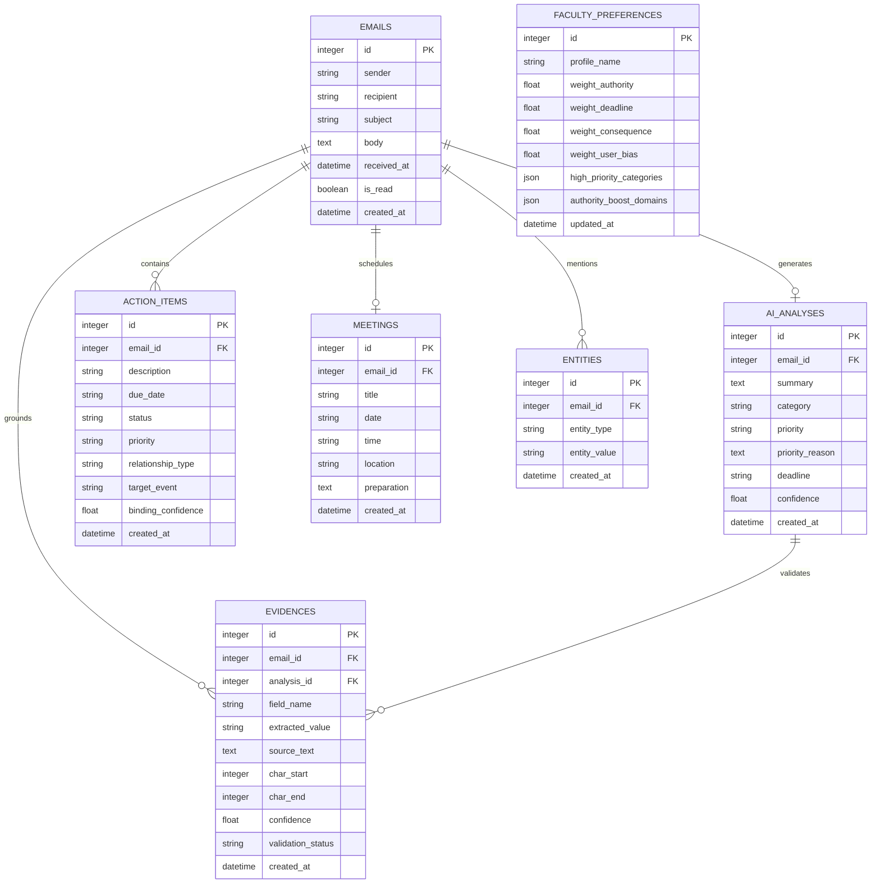

# Database Architecture Documentation

This document describes the relational database architecture, Entity-Relationship (ER) schema, indexing strategies, and transaction lifecycle for the **AI Email Summarizer Agent for Faculty**.

---

## 1. Relational Entity-Relationship Diagram

---

## 2. Table Specifications

### 2.1 Table: `emails`
The foundational table storing inbound raw correspondence.
- `id` (INTEGER, Primary Key, Autoincrement): Unique email identifier.
- `sender` (VARCHAR(255), Not Null): Sender email address.
- `recipient` (VARCHAR(255), Nullable): Recipient address.
- `subject` (VARCHAR(500), Not Null): Email subject line.
- `body` (TEXT, Not Null): Full text body of the email.
- `received_at` (DATETIME, Not Null, Index): Exact reception timestamp, serving as the temporal anchor ($T_0$).
- `is_read` (BOOLEAN, Default: False): Read/unread flag.
- `raw_headers` (TEXT, Nullable): Optional JSON metadata headers.
- `created_at` (DATETIME, Default: CURRENT_TIMESTAMP): Ingestion timestamp.

### 2.2 Table: `ai_analyses`
Stores synthesized executive intelligence and priority classification for an email.
- `id` (INTEGER, Primary Key, Autoincrement).
- `email_id` (INTEGER, Foreign Key -> `emails.id`, Unique, Not Null, `ON DELETE CASCADE`).
- `summary` (TEXT, Not Null): Concise, 2-to-3 sentence executive summary.
- `category` (VARCHAR(100), Not Null, Index): Assigned domain (*e.g., Examination, Administrative*).
- `priority` (VARCHAR(20), Not Null, Index): Priority tier (*HIGH, MEDIUM, LOW*).
- `priority_reason` (TEXT, Not Null): Traceable explanation justifying the tier.
- `deadline` (VARCHAR(50), Nullable): Normalized ISO deadline string (`YYYY-MM-DD`).
- `confidence` (FLOAT, Default: 1.0): Multi-agent consensus confidence score.

### 2.3 Table: `action_items`
Stores imperative tasks extracted from the email.
- `id` (INTEGER, Primary Key, Autoincrement).
- `email_id` (INTEGER, Foreign Key -> `emails.id`, Not Null, Index, `ON DELETE CASCADE`).
- `description` (VARCHAR(500), Not Null): Verbatim imperative task description.
- `due_date` (VARCHAR(50), Nullable): Bound due date string (`YYYY-MM-DD`).
- `status` (VARCHAR(20), Default: `"PENDING"`, Index): Task state (`PENDING` / `COMPLETED`).
- `priority` (VARCHAR(20), Default: `"MEDIUM"`): Relative task urgency.
- `relationship_type` (VARCHAR(50), Default: `"DUE_ON"`): Relational link type.
- `target_event` (VARCHAR(255), Nullable): Associated calendar event.
- `binding_confidence` (FLOAT, Default: 1.0): Confidence score for the action-deadline link.

### 2.4 Table: `meetings`
Stores structured calendar and venue intelligence.
- `id` (INTEGER, Primary Key, Autoincrement).
- `email_id` (INTEGER, Foreign Key -> `emails.id`, Unique, Not Null, `ON DELETE CASCADE`).
- `title` (VARCHAR(255), Not Null): Meeting agenda / subject.
- `date` (VARCHAR(50), Nullable): Meeting date (`YYYY-MM-DD`).
- `time` (VARCHAR(50), Nullable): Meeting time window (*e.g., 02:30 PM*).
- `location` (VARCHAR(255), Nullable): Physical room or virtual conference link.
- `preparation` (TEXT, Nullable): Mandatory prerequisite actions or files.

### 2.5 Table: `evidences`
Stores character-level citations linking AI extractions to verbatim source sentences.
- `id` (INTEGER, Primary Key, Autoincrement).
- `email_id` (INTEGER, Foreign Key -> `emails.id`, Not Null, Index, `ON DELETE CASCADE`).
- `analysis_id` (INTEGER, Foreign Key -> `ai_analyses.id`, Nullable, `ON DELETE CASCADE`).
- `field_name` (VARCHAR(50), Not Null): Extracted attribute (*summary, deadline, meeting, action*).
- `extracted_value` (TEXT, Not Null): Value produced by the model.
- `source_text` (TEXT, Not Null): Exact verbatim span from the email text.
- `char_start` (INTEGER, Nullable): 0-indexed character start offset in `email.body`.
- `char_end` (INTEGER, Nullable): 0-indexed character end offset in `email.body`.
- `validation_status` (VARCHAR(20), Default: `"VERIFIED"`): Grounding state (`VERIFIED` / `UNVERIFIED`).

### 2.6 Table: `faculty_preferences`
Stores configurable priority weights and domain override rules for personalized triage.
- `id` (INTEGER, Primary Key, Autoincrement).
- `profile_name` (VARCHAR(100), Not Null).
- `weight_authority` (FLOAT, Default: 0.35).
- `weight_deadline` (FLOAT, Default: 0.35).
- `weight_consequence` (FLOAT, Default: 0.20).
- `weight_user_bias` (FLOAT, Default: 0.10).
- `high_priority_categories` (JSON, Not Null): List of domains automatically promoted to HIGH.
- `authority_boost_domains` (JSON, Not Null): Domain suffixes receiving statutory authority boost.

---

## 3. Foreign Key Cascades & Referential Integrity

Referential integrity is strictly maintained via foreign keys configured with `ondelete="CASCADE"`. Deleting an email record from the `emails` table atomically and cleanly removes:
1. Associated record in `ai_analyses`
2. All associated `action_items`
3. Associated record in `meetings`
4. All associated `evidences`
5. All associated `entities`

This ensures that the database remains completely free of orphaned records without requiring manual multi-table deletion queries.

---

## 4. Idempotent Seeding Transactions

The application's startup lifecycle executes `seed_database(db)`. To prevent duplicate insertions across server restarts:
1. The seed function checks `db.query(Email).count()`.
2. If records exist, seeding is cleanly skipped.
3. If empty, the 12 synthetic academic emails are ingested, analyzed via `AIOrchestrator`, and committed within an atomic transaction.
4. Any failure during seeding triggers an automatic `db.rollback()` to prevent partial corruption.
